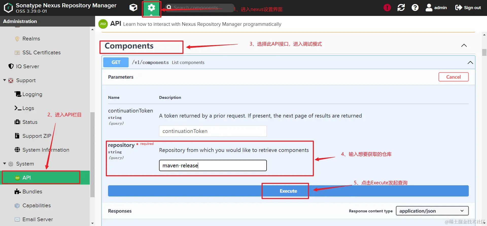
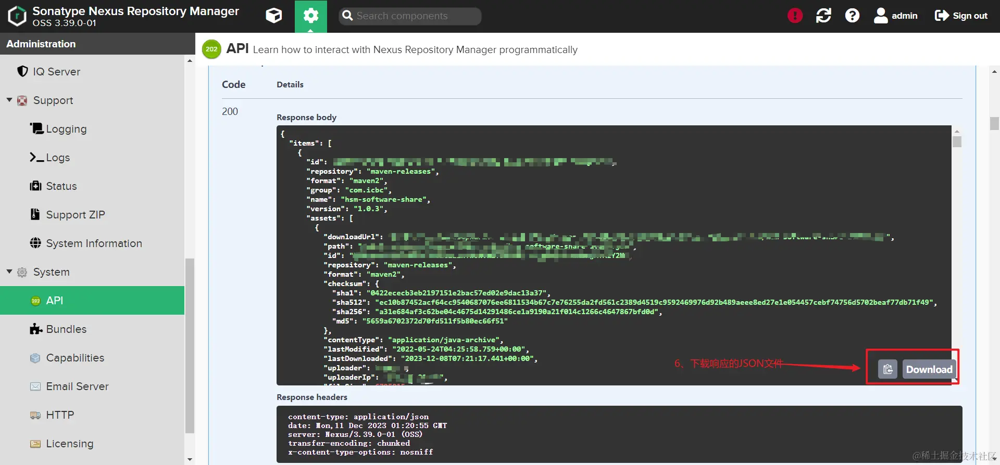

最近公司需要迁移maven私服，需要获取Nexus内全部的jar包，但是没有找到能下载全部Jar包的工具。研究Nexus的配置后发现，官方提供的调试API可以发送请求后获取到所在仓库全部jar包的URL，因此编写了个下载jar包的小工具。

## 0、实现原理

1. 调用nexus内的api接口，获取目标仓库所有jar包URL的JSON文件；
2. 解析JSON文件，获取所有jar包的URL；
3. 通过文件IO流将URL文件下载到本地；

## 1、获取文件URL





> 【注意】
>
> 调用请求时，并不会返回全部的jar包的JSON，需要将每次请求后得到的`continuationToken`参数回填到下一次的请求参数内，当`continuationToken`为`null`时，即表示当前仓库全部jar包下载完成。

## 2、实现步骤

将获取到的Nexus请求返回JSON文件放到，项目的`resources`目录下功后续解析使用

【解析JSON文件】

```java
private static HashMap<String, Object> parseJson() throws IOException {

    ObjectMapper objectMapper = new ObjectMapper();

    FileReader fileReader = new FileReader(JSON_FILE_PATH);
    BufferedReader bufferedReader = new BufferedReader(fileReader);
    StringBuffer sb = new StringBuffer();
    String s = "";
    while (StrUtil.isNotEmpty(s = bufferedReader.readLine())) {
        sb.append(s.trim());
    }
    return objectMapper.readValue(sb.toString(), HashMap.class);
}
```

【通过URL下载文件到本地】

```java
private static void genFile(final String urlStr, final String path) {
    System.out.println(path);

    URL url = null;
    try {
        url = new URL(urlStr);
        String tempFileName = path;

        // 先创建文件夹
        File t = new File(path);
        t.getParentFile().mkdirs();
        File temp = new File(tempFileName);
        FileUtils.copyURLToFile(url, temp);
    } catch (Exception e) {
        e.printStackTrace();
    }
}
```

【整合JSON解析和文件下载】

```java
public static void downloadFile() throws IOException {
    HashMap<String, Object> jsonMap = parseJson();

    List<Map> list = (List) jsonMap.get("items");

    for (Map map : list) {
        List<Map> assets = (List<Map>) map.get("assets");
        for (Map dMap : assets) {
            String url = String.valueOf(dMap.get("downloadUrl"));
            String path = String.valueOf(dMap.get("path"));
            // 生成文件
            genFile(url, NEXUS_PATH + path);
        }
    }

}
```

## 3、完整代码

【maven依赖】

```xml
<?xml version="1.0" encoding="UTF-8"?>
<project xmlns="http://maven.apache.org/POM/4.0.0"
  xmlns:xsi="http://www.w3.org/2001/XMLSchema-instance"
  xsi:schemaLocation="http://maven.apache.org/POM/4.0.0 http://maven.apache.org/xsd/maven-4.0.0.xsd">
  <modelVersion>4.0.0</modelVersion>

  <groupId>com.bruce</groupId>
  <artifactId>tools-nexus</artifactId>
  <version>1.0-SNAPSHOT</version>

  <properties>
    <maven.compiler.source>8</maven.compiler.source>
    <maven.compiler.target>8</maven.compiler.target>
    <project.build.sourceEncoding>UTF-8</project.build.sourceEncoding>
  </properties>

  <dependencies>
    <dependency>
      <groupId>cn.hutool</groupId>
      <artifactId>hutool-all</artifactId>
      <version>5.8.16</version>
    </dependency>
    <dependency>
      <groupId>org.jsoup</groupId>
      <artifactId>jsoup</artifactId>
      <version>1.11.3</version>
    </dependency>
    <dependency>
      <groupId>com.fasterxml.jackson.core</groupId>
      <artifactId>jackson-databind</artifactId>
      <version>2.11.3</version>
    </dependency>
    <!-- https://mvnrepository.com/artifact/commons-io/commons-io -->
    <dependency>
      <groupId>commons-io</groupId>
      <artifactId>commons-io</artifactId>
      <version>2.8.0</version>
    </dependency>
  </dependencies>

</project>
```

【完整Java代码】

```java
package com.bruce;

import cn.hutool.core.util.StrUtil;
import com.fasterxml.jackson.databind.ObjectMapper;
import org.apache.commons.io.FileUtils;

import java.io.BufferedReader;
import java.io.File;
import java.io.FileReader;
import java.io.IOException;
import java.net.URL;
import java.util.HashMap;
import java.util.List;
import java.util.Map;

/**
 * @author Bruce
 * @create 2023/12/08
 * @description 下载nexus指定仓库的全部jar包
 */
public abstract class DownloadJar {
    // 指定下载到本地路径
    private static final String NEXUS_PATH = "E:\nexus_path\";
    // 待解析JSON文件路径
    private static final String JSON_FILE_PATH = "E:\workspace\workspace05\tools-nexus\src\main\resources\nexus.json";

    /**
     * 启动任务
     */
    public static void main(String[] args) {
        System.out.println("=============启动下载任务===========");
        long startTime = System.currentTimeMillis();
        try {
            DownloadJar.downloadFile();
        } catch (Exception e) {
            System.out.println("==============出现异常==============");
            e.printStackTrace();
        }

        System.out.println("==============下载任务结束，耗时：" + (System.currentTimeMillis() - startTime)  + "ms==========");

    }

    public static void downloadFile() throws IOException {
        HashMap<String, Object> jsonMap = parseJson();

        List<Map> list = (List) jsonMap.get("items");

        for (Map map : list) {
            List<Map> assets = (List<Map>) map.get("assets");
            for (Map dMap : assets) {
                String url = String.valueOf(dMap.get("downloadUrl"));
                String path = String.valueOf(dMap.get("path"));
                // 生成文件
                genFile(url, NEXUS_PATH + path);
            }
        }

    }

    /**
     * 读取解析JSON
     */
    private static HashMap<String, Object> parseJson() throws IOException {

        ObjectMapper objectMapper = new ObjectMapper();

        FileReader fileReader = new FileReader(JSON_FILE_PATH);
        BufferedReader bufferedReader = new BufferedReader(fileReader);
        StringBuffer sb = new StringBuffer();
        String s = "";
        while (StrUtil.isNotEmpty(s = bufferedReader.readLine())) {
            sb.append(s.trim());
        }
        return objectMapper.readValue(sb.toString(), HashMap.class);
    }

    /**
     * 生成文件
     */
    private static void genFile(final String urlStr, final String path) {
        System.out.println(path);

        URL url = null;
        try {
            url = new URL(urlStr);
            String tempFileName = path;

            // 先创建文件夹
            File t = new File(path);
            t.getParentFile().mkdirs();
            File temp = new File(tempFileName);
            FileUtils.copyURLToFile(url, temp);
        } catch (Exception e) {
            e.printStackTrace();
        }
    }

}
```

完整项目地址：[github.com/Real-Bruce/…](https://github.com/Real-Bruce/micro-tools)
