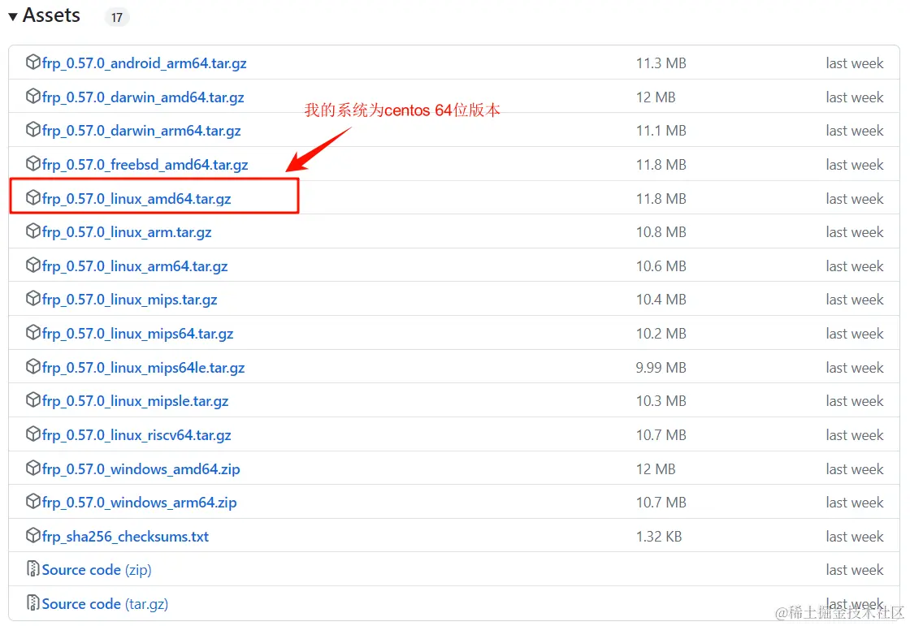
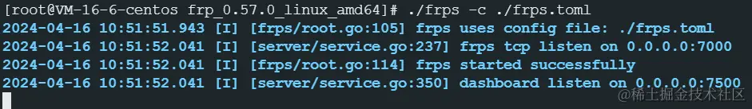
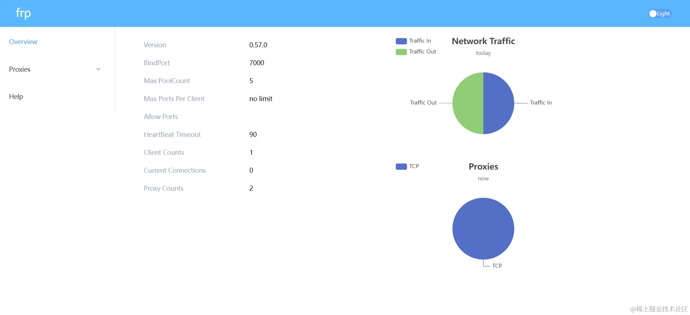
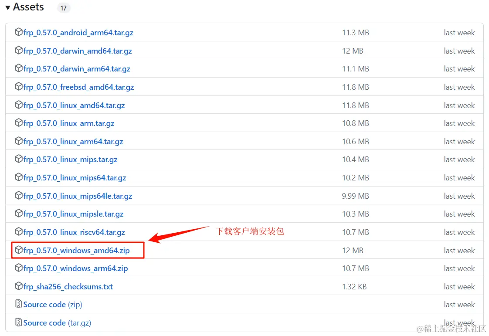
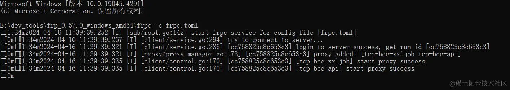

## 1、frp简介

frp 是一款高性能的反向代理应用，专注于内网穿透。它支持多种协议，包括 TCP、UDP、HTTP、HTTPS 等，并且具备 P2P 通信功能。使用 frp，您可以安全、便捷地将内网服务暴露到公网，通过拥有公网 IP 的节点进行中转。

官网地址：[gofrp.org/zh-cn/docs/…](https://gofrp.org/zh-cn/docs/overview/)

## 2、工作原理

frp 主要由两个组件组成：客户端(frpc) 和 服务端(frps)。通常情况下，服务端部署在具有公网 IP 地址的机器上，而客户端部署在需要穿透的内网服务所在的机器上。

由于内网服务缺乏公网 IP 地址，因此无法直接被非局域网内的用户访问。用户通过访问服务端的 frps，frp 负责根据请求的端口或其他信息将请求路由到相应的内网机器，从而实现通信。

## 3、使用方法

frp搭建分为服务端(frps)和客户端(frpc)，其中服务端需要搭建在有公网固定IP的机器上，客户端则搭建在需要被代理的内网机器上。

### 3.1 搭建服务端frps

【下载解压安装包】

安装包地址：[github.com/fatedier/fr…](https://github.com/fatedier/frp/releases)

下载对应服务器版本的压缩包，比如我的服务端机器为centos 64 位版本，则下载如图所示：



下载后使用ftp工具上传到服务器，或者使用 `wget`命令下载

```bash
 wget https://github.com/fatedier/frp/releases/download/v0.57.0/frp_0.57.0_linux_amd64.tar.gz
```

将frp压缩包上传或下载到服务器后，解压压缩包，可以看到以下文件：

```bash
 tar -zxvf frp_0.57.0_linux_amd64.tar.gz 
```


【修改配置文件】

切换到frp解压后的文件夹内 `cd /root/frp` ，修改配置文件：`vim frps.toml`

```toml
 bindPort = 7000
 ​
 # auth 配置服务端与客户端访问token
 auth.token = "1232132"
 ​
 # web-ui 开启web界面监控
 # 默认为 127.0.0.1，如果需要公网访问，需要修改为 0.0.0.0。
 webServer.addr = "0.0.0.0"
 webServer.port = 7500
 # dashboard 用户名密码，可选，默认为空
 webServer.user = "admin"
 webServer.password = "admin"
```

> 注意：
>
> 需要配置防火墙打开 `7000,7500` 端口，否侧会不能访问
>
> 更多的配置信息请查看官方文档：[gofrp.org/zh-cn/docs/…](https://gofrp.org/zh-cn/docs/features/common/configure/)

【启动服务】

使用以下命令启动服务

```bash
 ./frps -c ./frps.toml
```

出现以下信息表示frp服务端启动成功



浏览器打开访问 `http://your ip:7500` 可以进入web监控界面，输入设置的账号密码即可查看出每个代理的出入网流量；



> 注意：此处启动的方式为前台启动，退出ssh连接或关闭关闭控制台会退出服务
>
> 可以使用systemd设置为后台服务进行管理，配置方式：[gofrp.org/zh-cn/docs/…](https://gofrp.org/zh-cn/docs/setup/systemd/)

### 3.2 搭建客户端frpc

【下载解压安装包】

安装包地址：[github.com/fatedier/fr…](https://github.com/fatedier/frp/releases)

下载对应服务器版本的压缩包，比如我的客户端机器为windows 64 位版本，则下载如图所示：



解压后的文件如下：


【修改配置文件】

使用记事本或submit等工具打开 `frpc.toml`，修改配置信息可配置多个端口代理

```toml
 # 公网服务器IP
 serverAddr = "xxx.xxx.xxx.xxx"
 serverPort = 7000
 ​
 # auth 访问公网部署的服务端的token，服务端与客户端需要保持一致
 auth.token = "1232132"
 ​
 [[proxies]]
 name = "tcp-demo-1"
 type = "tcp"
 # 内网服务器地址
 localIP = "127.0.0.1"
 # 内网服务端口
 localPort = 6666
 # 公网服务器代理端口
 remotePort = 6666
```

> 注意：
>
> 此处配置的 `remotePort` 需要在公网服务器防火墙上配置端口开放，否则不能访问；
>
> 更多的配置信息请查看官方文档：[gofrp.org/zh-cn/docs/…](https://gofrp.org/zh-cn/docs/features/common/configure/)

【启动服务】

切换到frp文件所在的路径，打开cmd窗口输入如下命令，启动frp客户端

```bat
 frpc -c  frpc.toml
```


