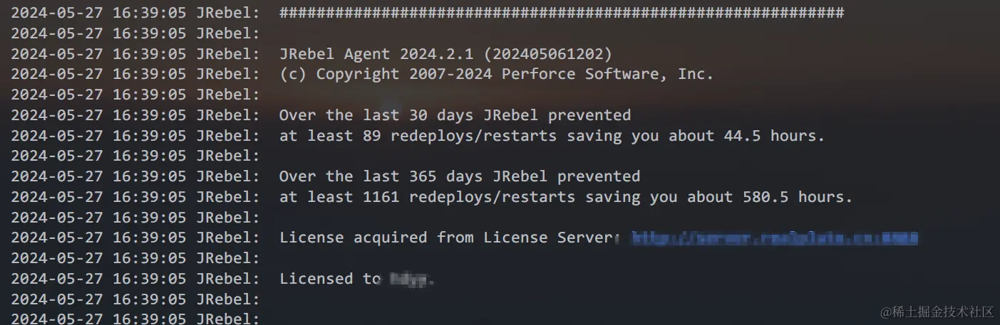
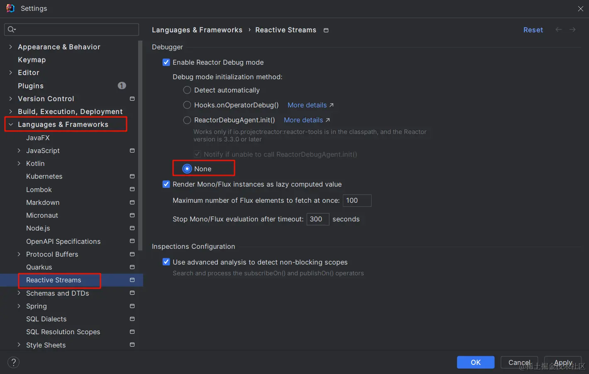

## 版本&环境

系统版本：win10

idea版本：IntelliJ IDEA 2023.3.6 (Ultimate Edition)

Jrebel版本：2024.2.1

## 问题现象

使用Jrebel debug模式启动项目时，显示完Jrebel授权信息后项目不能正常启动，如图1-1所示

| 图1-1 Jrebel启动失败图 |
| - |
|  |

## 原因&解决

**问题产生原因** ：

idea 2023.3.x后续版本修改了 reactive streams的默认配置，导致Jrebel不能正确debug启动

**解决方式：**

修改以下位置的配置信息， `setting -> Languages & Frameworks -> Reactive Streams -> Debugger -> none` ，具体配置信息查看图2-1；

配置修改完成后重新使用Jrebel debug模式启动项目，项目正常加载。

| 图1-2 需要修改的配置 |
| - |
|  |
