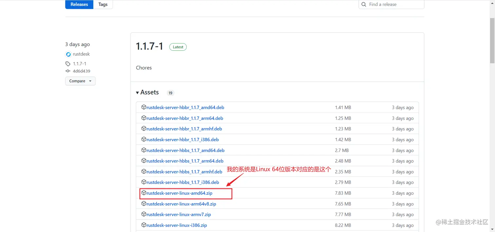
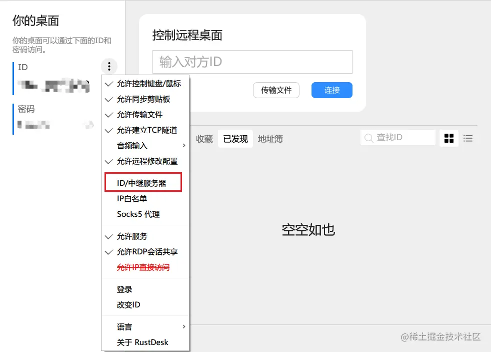
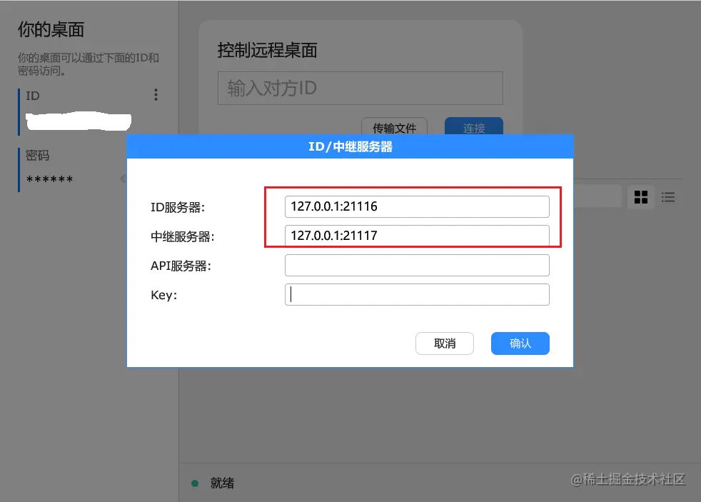

因为工作原因经常需要连接公司的电脑进行远程的代码调试和数据处理，用过很多的远程桌面工具，但是奈何远程连接工具都是要收费的，不付费就只能忍受辣眼睛的画质，特别是疫情隔离期间对远程桌面的需求极具增加。最终在白嫖过无数远程连接工具后终于找到了开源且可以自己搭建的远程桌面程序 [RustDesk](https://rustdesk.com/)

## 1、简介

开源的虚拟与远程桌面基础架构。远程桌面软件，开箱即用，无需任何配置。您完全掌控数据，不用担心安全问题。您可以使用我们的注册/中继服务器，或者自建，亦或者开发您的版本。

如果只是使用RustDesk软件且不需要自己搭建服务器的话，可以直接在官网下载对应的系统版本即可使用，不过由于共享使用作者的服务器画质和响应速度可能存在问题。此处建议有自己云服务器的同学自己搭建中继服务器，画质和响应速度会得到大幅度提升。

软件官网：[RustDesk](https://rustdesk.com/)

## 2、搭建中继服务器

本博客基于：CentOS Linux release 7.6.1810搭建，并采用pm2 启动的方式进行管理，docker搭建方式没有尝试成功，欢迎搭建成功的同学一起交流。

> 自建中继服务器基本要求：
>
> 硬件要求很低，最低配置的云服务器就可以了，CPU和内存要求都是最小的。关于网络大小，如果TCP打洞直连失败，就要耗费中继流量，一个中继连接的流量在30k-3M每秒之间（1920x1080屏幕），取决于清晰度设置和画面变化。如果只是办公需求，平均在100K/s。

### 2.1 下载中继服务器软件

#### 2.1.1 进入RustDeck官网下载软件

官网下载地址：[rustdesk-server](https://github.com/rustdesk/rustdesk-server)，找的与自己系统相匹配的软件包，如图2-1所示

| 图2-1 中继软件下载 |
| - |
|  |

> 补充一些关于Linux系统中软件区分的资料
>
> - [Linux下软件包的分类及deb、rpm、tar.gz的区别](https://blog.csdn.net/liu865033503/article/details/86014773)
> - [x86/x64/x86-64/amd64/arm指令集架构之间的关系](https://zhuanlan.zhihu.com/p/113157931)

#### 2.1.2 上传到自己的服务器

① 在 `/usr/local/lib` 目录下建立文件夹 `rustdesk`

```cpp
 mkdir rustdesk
```

② 使用FTP软件上传软件包到 `/usr/local/lib/rustdesk` 目录下

或者使用 `wget` 命令直接下载

```ruby
 wget https://github.com/rustdesk/rustdesk-server/releases/download/1.1.7-1/rustdesk-server-linux-amd64.zip
```

③ 解压软件包

```python
 unzip rustdesk-server-linux-amd64.zip
```

> 此时软件包以及可以使用，但是建议安装pm2进行服务的启停和管理
>
> 启动命令
>
> ```bash
>  ./hbbs -r <hbbr运行所在主机的地址[:port]> 
>  ./hbbr
> ```

### 2.2 安装nodejs

① 在 `/usr/local/lib` 目录下建立文件夹 `nodejs`

```cpp
 mkdir nodejs
```

② 下载nodejs，[nodejs官网](https://nodejs.org/zh-cn/download/)使用FTP软件上传到目录 `/usr/local/lib/nodejs`

或者使用 `wget` 命令直接下载

```bash
 wget https://nodejs.org/dist/v16.14.0/node-v16.14.0-linux-x64.tar.xz
```

> 注意：需要安装nodejs16+版本

③ 解压文件，配置软连接

```bash
 # 解压文件
 tar -xvf node-v16.14.0-linux-x64.tar.xz
 # 配置软连接
 ln -s /usr/local/lib/nodejs/node-v16.14.0-linux-x64/bin/node /usr/local/bin
 ln -s /usr/local/lib/nodejs/node-v16.14.0-linux-x64/bin/npm /usr/local/bin
```

④ 检查是否配置成功

```text
 node -v
 npm -v
```

### 2.3 安装pm2包并启动服务

① 使用npm命令安装pm2

```text
 npm install -g pm2
```

② 使用pm2 运行 hbbs/hbbr

进入中继软件所在目录执行以下命令

```sql
 pm2 start hbbs -- -r <your-relay-server-ip[:port]> 
 pm2 start hbbr 
```

③ 查看服务运行情况

```text
 pm2 list
```

> hhbs的`-r`参数不是必须的，他只是方便你不用在客户端指定中继服务器，如果是默认21117端口，可以不填port。客户端指定的中继服务器优先级高于这个。
>
> 官网指出填不填都可以，但是处于保险起见最好加上参数；

### 2.4 配置防火墙

找到你服务器的防火墙或安全组配置，开放以下端口，如图2-2所示；

- TCP(**21115, 21116, 21117, 21118, 21119**)
- UDP(**21116**)

| 图2-2 防火墙配置 |
| - |
|  |

> 务必在防火墙开启这几个端口， **请注意21116同时要开启TCP和UDP**。
>
> - hbbs 监听21115(tcp), 21116(tcp/udp), 21118(tcp)；
> - hbbr 监听21117(tcp), 21119(tcp)；
>
> * 21115是hbbs用作NAT类型测试；
> * 21116/UDP是hbbs用作ID注册与心跳服务；
> * 21116/TCP是hbbs用作TCP打洞与连接服务；
> * 21117是hbbr用作中继服务, 21118和21119是为了支持网页客户端；
> * 如果您不需要网页客户端（21118，21119）支持，对应端口可以不开；

## 3、配置使用

### 3.1 不使用密钥连接

将第二步配置好的服务器地址，填写到RustDesk软件的ID/中继服务器配置，配置完成后即可进行远程连接。

① 打开RustDesk软件，找到菜单选项，如图3-1所示；

| 图 3-1 配置中继服务器 |
| - |
|  |

② 配置ID服务器和中继服务器地址，如图3-2所示

| 图 3-2 ID服务器地址配置 |
| - |
|  |

> 注意：
>
> ① 修改IP地址为你自己的IP地址！！！
>
> ② 连接端和被连接端都需要添加中继服务器配置！！！

### 3.2 使用密钥链接

上述中配置完成后已经可以进行正常的远程桌面操作和访问，但是因为通信之间没有进行加密，难免会被恶意攻击和盗取数据，因此建议中继地址加入强制密钥访问。

① 重启 `hbbs/hbbr` 服务强制开启加密连接

```sql
 pm2 start hbbs -r <relay-server-ip[:port]> -k _
 pm2 start hbbr -k _
```

② 找到密钥文件

密钥文件配置在中继软件目录下的 `id_ed25519.pub`，使用命令查看密钥

```bash
 cat ./id_ed25519.pub
```

③ 配置密钥

配置同图3-2，在key选项处添加的密钥信息即可实现加密连接；

> 【参考资料】
>
> 官方搭建文档：[rustdesk.com/do](https://rustdesk.com/docs/zh-cn/self-host/install/)
