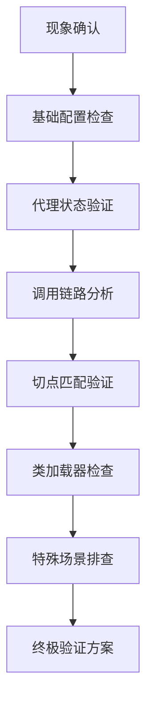
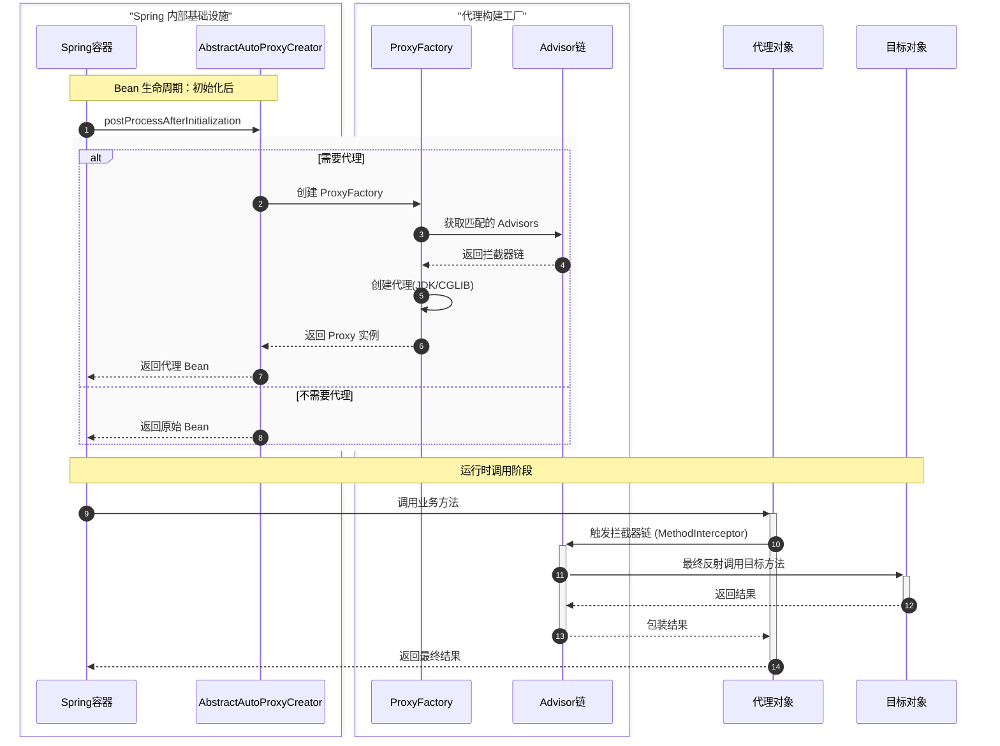

## 一、系统化排查流程（8 步诊断法）



***

## 二、详细排查步骤

### 1. 失效现象确认

**关键日志**：检查类名是否包含代理标识

```text
// 正常代理类名
com.example.ServiceImpl$$EnhancerBySpringCGLIB$$12345

// 异常情况（无代理）
com.example.ServiceImpl
```

**启用调试模式**：

```properties
# application.properties
logging.level.org.springframework.aop=TRACE
logging.level.org.springframework.context=DEBUG
```

### 2. 基础配置检查

| 检查项 | 验证方法 | 修复方案 |
| - | - | - |
| `@EnableAspectJAutoProxy` | 检查启动类/配置类是否添加 | 添加注解并设置 `proxyTargetClass=true` |
| 切面 Bean 注册 | 在切面类添加 `@Component` 或 XML 配置 `<bean>` | 确保切面被 Spring 管理 |
| 包扫描路径 | 检查 `@ComponentScan` 是否包含切面所在包 | 调整扫描范围 |
| 代理模式设置 | 检查 `spring.aop.proxy-target-class` 值 | 设置为 true 强制使用 CGLIB |

### 3. 代理状态验证

**代码验证方案**：

```java
// 在调用处添加诊断代码
import org.springframework.aop.support.AopUtils;

public void validateProxy(Object bean) {
    System.out.println("===== AOP代理状态诊断 =====");
    System.out.println("Bean类型: " + bean.getClass().getName());
    System.out.println("是否AOP代理: " + AopUtils.isAopProxy(bean));
    System.out.println("是否CGLIB代理: " + AopUtils.isCglibProxy(bean));
    System.out.println("是否JDK动态代理: " + AopUtils.isJdkDynamicProxy(bean));
  
    if(AopUtils.isAopProxy(bean)) {
        System.out.println("目标类: " + AopUtils.getTargetClass(bean).getName());
    }
}
```

**控制台预期输出**：

```text
===== AOP代理状态诊断 =====
Bean类型: com.example.Service$$EnhancerBySpringCGLIB$$2e4e5d
是否AOP代理: true
是否CGLIB代理: true
是否JDK动态代理: false
目标类: com.example.ServiceImpl
```

### 4. 调用链路分析

**【内部调用问题】**

```java
@Service
public class OrderService {
  
    // 外部调用：代理生效
    public void processOrder() {
        validateStock(); // 内部调用：代理失效！
    }
  
    @CustomAnnotation
    public void validateStock() {
        // 切面逻辑
    }
}
```

**解决方案**：

```java
public void processOrder() {
    // 通过AopContext获取当前代理
    OrderService proxy = (OrderService) AopContext.currentProxy();
    proxy.validateStock(); // 通过代理调用
}
```

**【框架集成点】**

```java
// WebService端点注册诊断
@Bean
public Endpoint endpoint() {
    Object service = new ServiceImpl(); // 错误：直接实例化
    // Object service = context.getBean(Service.class); // 正确
    return new EndpointImpl(service);
}
```

### 5. 切点匹配验证

**【表达式验证工具】**

```java
@Autowired
private ApplicationContext context;

public void validatePointcut() {
    AspectJExpressionPointcut pointcut = new AspectJExpressionPointcut();
    pointcut.setExpression("@annotation(com.example.CustomAnnotation)");
  
    Class<?> targetClass = ServiceImpl.class;
    Method method = targetClass.getMethod("targetMethod");
  
    System.out.println("类匹配: " + pointcut.matches(targetClass));
    System.out.println("方法匹配: " + pointcut.matches(method, targetClass));
}
```

**常见匹配问题**：

1. 注解继承失效;
2. 作用域限制;

**注解继承失效**：

```java
// 父类方法
public class BaseService {
    @CustomAnnotation
    public void baseMethod() {}
}
 
// 子类
public class SubService extends BaseService {
    @Override
    public void baseMethod() {} // 切点失效
}
```

> **修复**：使用 `@within` 替代 `@annotation`

```java
@Before("@within(com.example.CustomAnnotation)")
```

**作用域限制**：

```java
@Service
@Scope(proxyMode = ScopedProxyMode.NO) // 禁用代理
public class SpecialService {...}
```

### 6. 类加载器检查

**诊断代码**：

```java
public void checkClassLoader() {
    System.out.println("===== 类加载器诊断 =====");
    System.out.println("切面类加载器: " + LoggingAspect.class.getClassLoader());
    System.out.println("目标类加载器: " + ServiceImpl.class.getClassLoader());
    System.out.println("Spring容器类加载器: " + this.getClass().getClassLoader());
  
    // 检查是否相同类加载器
    boolean sameLoader = LoggingAspect.class.getClassLoader() 
                         == ServiceImpl.class.getClassLoader();
    System.out.println("是否相同类加载器: " + sameLoader);
}
```

**典型问题场景**：

1. **OSGi 环境**：模块化类加载导致切面不可见
2. **Spring Boot DevTools**：重启类加载器隔离

```xml
<!-- 排除DevTools解决类加载问题 -->
<dependency>
    <groupId>org.springframework.boot</groupId>
    <artifactId>spring-boot-starter-web</artifactId>
    <exclusions>
        <exclusion>
            <groupId>org.springframework.boot</groupId>
            <artifactId>spring-boot-devtools</artifactId>
        </exclusion>
    </exclusions>
</dependency>
```

### 7. 特殊场景排查

| 场景 | 现象 | 解决方案 |
| - | - | - |
| **异步方法** | `@Async` 方法切面失效 | 配置 `@EnableAsync(proxyTargetClass=true)` |
| **事务管理** | `@Transactional` 不生效 | 检查是否同一类内调用 |
| **构造函数注入** | 切面依赖的 Bean 为 null | 改用 setter 注入或 `@PostConstruct` |
| **Bean 初始化顺序** | 切面在目标 Bean 之后初始化 | 实现 `Ordered` 接口调整顺序 |
| **Lombok 代理冲突** | `@Data` 导致代理异常 | 添加 `@Getter/@Setter` 替代 |

### 8. 终极解决方案

**AspectJ 织入模式验证**：

1. 添加依赖；
2. 启用 LTW（Load-Time Weaving）；
3. 添加 aop.xml；
4. 设置 JVM 参数；

**添加依赖：**

```xml
<dependency>
    <groupId>org.springframework.boot</groupId>
    <artifactId>spring-boot-starter-aop</artifactId>
</dependency>
<dependency>
    <groupId>org.aspectj</groupId>
    <artifactId>aspectjweaver</artifactId>
    <version>1.9.7</version>
</dependency>
```

**启用 LTW（Load-Time Weaving）：**

```java
@Configuration
@EnableLoadTimeWeaving
public class AspectJConfig {}
```

**添加 aop.xml：**

```xml
<!-- META-INF/aop.xml -->
<aspectj>
    <weaver>
        <include within="com.example..*"/>
    </weaver>
    <aspects>
        <aspect name="com.example.LoggingAspect"/>
    </aspects>
</aspectj>
```

**设置 JVM 参数：**

```bash
-javaagent:path/to/spring-instrument.jar
```

***

## 三、Spring AOP 执行全流程解析



**关键阶段说明**：

1. **代理决策点**：`AbstractAutoProxyCreator.postProcessAfterInitialization()`
2. **代理创建**：`ProxyFactory.getProxy()`
3. **拦截链构建**：`AdvisedSupport.getInterceptorsAndDynamicInterceptionAdvice()`
4. **调用执行**：`ReflectiveMethodInvocation.proceed()`

***

## 四、高频失效原因速查表

| 失效原因 | 发生概率 | 典型场景 | 快速验证方法 |
| - | - | - | - |
| 内部方法调用 | ★★★★★ | 同类中非代理方法调用带注解方法 | 添加 `AopContext.currentProxy()` |
| 端点绑定实现类 | ★★★★☆ | WebService/JMS/MQ 端点直接 new 实现类 | 检查 Endpoint 注册代码 |
| 切点表达式不匹配 | ★★★★☆ | 1. 包路径错误<br>2. 注解继承问题<br>3. 访问修饰符限制 | 使用 `Pointcut` 验证工具 |
| 代理模式配置错误 | ★★★☆☆ | 1. 缺少 `proxyTargetClass=true`<br>2. final 类使用 CGLIB 失败 | 检查 `spring.aop.proxy-target-class` |
| 类加载器隔离 | ★★☆☆☆ | 1. Spring Boot DevTools<br>2. OSGi 环境<br>3. 自定义 ClassLoader | 打印类加载器信息 |
| Bean 初始化顺序 | ★★☆☆☆ | 切面在目标 Bean 之后初始化 | 实现 `Ordered` 接口调整优先级 |
| 特殊框架集成问题 | ★☆☆☆☆ | 1. gRPC 服务端<br>2. Netty 处理器<br>3. JNI 本地方法 | 切换为 AspectJ 模式 |

> 通过以上排查流程，可解决 95% 以上的 Spring AOP 失效问题。对于极端场景，AspectJ LTW 模式是终极解决方案。
